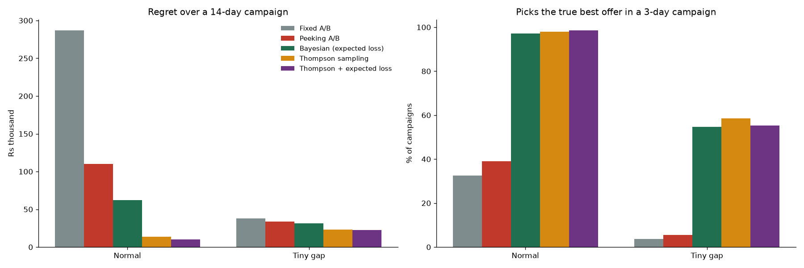
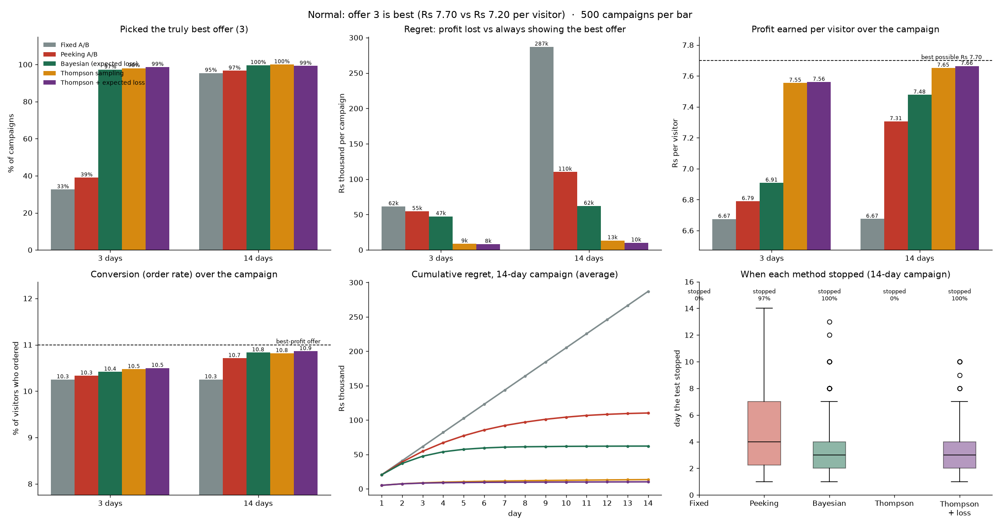
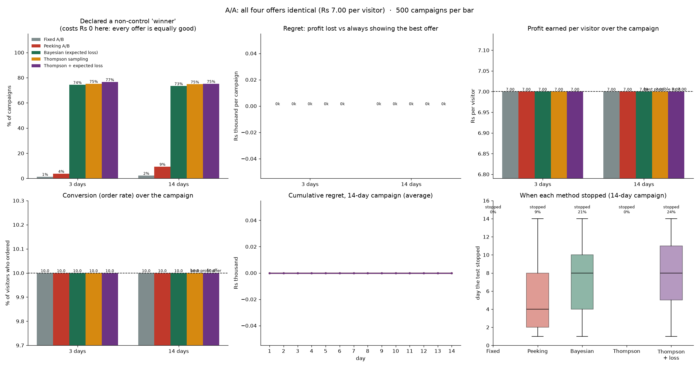

<p align="center">
  
</p>

# Real-Time Bayesian Experimentation Engine

> *Every day an offer test runs, some customers are shown the loser, and nobody can tell yet
> which one it is. What if the experiment could learn while it runs?*

A simulator and decision engine for choosing between checkout offers on a quick-commerce app
(Blinkit / Zomato style). It asks one question: **can Bayesian methods pick a more profitable
offer, faster and with less wasted traffic, than a standard fixed-length A/B test?**

All data is simulated, so every method can be scored against the known truth.
The full project log is in [`journal.pdf`](journal.pdf).



---

## Results in one table

Normal scenario (offer 3 is truly best), 500 simulated campaigns per cell:

| Method | Picks the best offer, 3-day campaign | Picks the best offer, 14-day campaign | Profit lost while testing, 14 days | Profit per visitor, 14 days |
|---|---|---|---|---|
| Fixed A/B test (industry baseline) | 33% | 95% | ₹287,006 | ₹6.68 |
| Peeking A/B test (checked every evening) | 39% | 97% | ₹110,267 | ₹7.31 |
| Bayesian expected-loss stopping | 97% | 99.6% | ₹62,144 | ₹7.48 |
| Thompson sampling | 98% | 100% | ₹13,430 | ₹7.65 |
| **Thompson + expected-loss stopping** | **99%** | **99%** | **₹10,197** | **₹7.66** |

The best possible profit per visitor is ₹7.70. The combined Bayesian engine loses **about 28 times
less** money than the fixed A/B test and finds the right offer in a 3-day campaign, where the
fixed test succeeds only one time in three.

---

## What it does

**The simulator** produces a realistic stream of cart-page visits for four competing offers.

| Capability | How it works |
|---|---|
| **Traffic that follows the clock** | Poisson arrivals whose rate changes through the day: quiet nights, a midday plateau and a large evening peak |
| **Fresh randomness every day** | Each simulated day draws its own visit counts, so days differ the way real days do |
| **Returning customers** | A configurable share of visits comes from users who visited before |
| **Fair, repeatable offer assignment** | A salted SHA-256 hash maps each user to one offer, so a returning user always sees the same offer |
| **Order outcomes with a known truth** | Each visit orders with the offer's true probability and earns the offer's profit if it does |
| **Fast batch simulator** | An hourly version draws visits, splits and orders per offer at once, so 500 campaigns run in seconds |

**The decision methods** (`Simulations/policies.py`), each a small class with the same interface:

| Method | Traffic split while testing | When it decides |
|---|---|---|
| Fixed A/B test | Equal | At the end, Welch's t-test on profit per visitor with a Bonferroni correction |
| Peeking A/B test | Equal | Every evening, at the first significant result |
| Bayesian expected loss | Equal | When picking the leading offer would cost less than ₹0.01 per visitor in expectation |
| Thompson sampling | Each offer's probability of being best, updated hourly | Never stops; traffic drifts to the winner |
| Thompson + expected loss | As Thompson | As Bayesian expected loss |

Every Bayesian method uses the same belief: a Beta posterior for each offer's order rate,
multiplied by its profit per order, so decisions are made on **profit**, not conversion.

The four offers (toy values, chosen so the best offer for conversion is the worst for profit):

| Offer | True order rate | Profit per order | Profit per visitor |
|---|---|---|---|
| 0. No offer (control) | 8% | ₹90 | ₹7.20 |
| 1. Free delivery | 10% | ₹70 | ₹7.00 |
| 2. ₹50 off | 12% | ₹40 | ₹4.80 |
| 3. ₹20 off above ₹299 | 11% | ₹70 | **₹7.70** |

---

## Results by scenario

Every figure below averages 500 independent campaigns per method and campaign length.

### Normal: offer 3 is truly best



- Every Bayesian method finds offer 3 in a **3-day** campaign at least 97% of the time; the fixed
  test needs about 14 days to reach 95%.
- No method falls for offer 2, even though it converts best, because all decisions use profit per visitor.
- Thompson-based methods keep profit per visitor within 1% of the best possible (₹7.65–7.66 vs ₹7.70).

### A/A: all four offers are identical



| Method | Declares a non-control "winner", 14 days |
|---|---|
| Fixed A/B test | 2.2% |
| Peeking A/B test | **9.4%** |
| Bayesian methods | about 75% |

- **Peeking multiplies false alarms about four times**: the same test, checked every evening.
- The Bayesian methods pick among identical offers at random, which costs ₹0 because every offer is
  equally good. They also rarely stop early when nothing is better: expected-loss stopping ends only
  21–24% of A/A campaigns, with a median stop on day 8. These methods should therefore be read as
  **decision tools**, not as tools that certify an effect.

### Tiny gap: offer 3 is better by only 2.5%

| Method | Picks offer 3, 14 days | Profit lost, 14 days |
|---|---|---|
| Fixed A/B test | 16% | ₹37,801 |
| Peeking A/B test | 26% | ₹33,747 |
| Bayesian expected loss | 77% | ₹31,672 |
| Thompson sampling | 86% | ₹23,138 |
| Thompson + expected loss | 86% | ₹22,670 |

A difference this small is nearly invisible to the fixed test after two weeks. The Bayesian methods
still find it most of the time, although the money at stake is small for every method.

---

## Honest limits

- **Bandits choose well but measure poorly.** Losing offers receive little traffic, so their effect
  sizes are imprecise. When a team needs an unbiased estimate of an effect, a fixed test is the right tool.
- **Bayesian methods have no built-in protection for control.** In an A/A test they switch between
  identical offers freely. That costs nothing here, but a real rollout has switching costs.
- **The threshold is a business choice.** ₹0.01 per visitor was used throughout; a stricter
  threshold means slower but safer decisions.
- **The data is synthetic.** Rates do not drift over time, there are no novelty effects, and orders equal demand.

---

## Assumptions

Everything here is chosen by hand unless a source is named.

| Area | Assumption |
|---|---|
| **Data** | Fully synthetic. No Eternal, Blinkit or Zomato data is used |
| **Traffic volume** | About 20,000 cart-page visits a day |
| **Daily shape** | Share of the day's traffic: 07–11 → 16%, 11–17 → 24%, 17–23 → 46%, 23–02 → 10%, 02–07 → 4%. The windows follow ranges in an industry article (see Sources), which cites no dataset, so they are plausible ranges rather than measured truth. The 02–07 floor is my own choice |
| **Arrivals** | Visits are independent, with a rate that is flat within each window |
| **Returning visits** | 15% of visits come from a user who already visited in the campaign window (an assumption) |
| **Orders** | Each visit is an independent draw with the offer's true order rate |
| **Profit** | Fixed per order for each offer (margin minus discount cost) |
| **Scenarios** | Normal (table above); A/A (all rates 0.10, all profits ₹70); tiny gap (rates 0.080, 0.080, 0.080, 0.082, all profits ₹90) |

---

## Simulator checks

Measured on the per-visit simulator over 3 days (seed 42, 60,374 visits).

| Check | Target | Result |
|---|---|---|
| Visits per day | about 20,000, varying day to day | 20,320 / 19,884 / 20,170 |
| Share of visits in each time window | 4 / 16 / 24 / 46 / 10 % | 4.0 / 16.1 / 24.0 / 46.0 / 9.9 % |
| Returning share | 15% | 15.1% |
| Users shown more than one offer | 0 | 0 |
| Two experiments assigned independently (16 combinations, expected 6,250 each) | even spread | 6,100–6,429, whereas plain `user_id % 4` fills only 4 of the 16 combinations |
| Fixed test's false-alarm rate in A/A | about 2% (theory) | 1.4% (3 days), 2.2% (14 days) |
| Fixed test's power, normal scenario | about 30% / 95% (theory) | 33% / 95% |

---

## Run it

The scripts read `config.ini` from the current directory, so run them from inside `Simulations/`.

```text
cd Simulations
python visit_simulator.py   # one realistic run, visit by visit
python hourly_simulator.py  # one fast run with a per-offer table and checks
python monte_carlo.py       # 500 campaigns of one method and scenario
```

Choose the scenario and campaign length in `config.ini`, and the method in `monte_carlo.py`
(`policy = ...`). Results go to `outputs/monte_carlo/summary_*.csv` and `daily_regret_*.csv`;
`outputs/final_summary.csv` collects every scenario and method.
Dependencies: `numpy`, `pandas`, `scipy`, `matplotlib`. Python 3.13 was used.

| `config.ini` section | Keys |
|---|---|
| `[scenario_normal]`, `[scenario_aa]`, `[scenario_tiny]` | `rates`, `profits`: one value per offer |
| `[traffic_shares]` | equal split used by the fixed tests |
| `[experiment]` | `id` (hash salt), `seed`, `no_of_arms`, `scenario`, `days`, `visitors_per_day`, `returning_visit_share`, `total_distinct_users`, `number_of_campaigns` |

---

## Future scope

- Run campaigns in parallel across CPU cores (about 10 times faster, identical results).
- Simulate all campaigns at once as arrays (50–100 times faster; needs a rewrite of the loop).
- A live decision service: each offer's posterior held in Redis, with FastAPI endpoints to assign an
  offer and record an outcome.

---

## Sources

- Daypart shares: Swapnil Gupta, Zane, *Quick-commerce daypart ad pacing and hourly budgets*
  (2 Aug 2026), <https://zane.marketing/quick-commerce-daypart-ad-pacing-hourly-budgets/>
- W. R. Thompson, *On the likelihood that one unknown probability exceeds another in view of the
  evidence of two samples*, Biometrika (1933)
- Russo et al., *A Tutorial on Thompson Sampling*, <https://arxiv.org/abs/1707.02038>
- Chris Stucchio, *Bayesian A/B Testing at VWO*, <https://www.chrisstucchio.com/pubs/VWO_SmartStats_technical_whitepaper.pdf>
- Evan Miller, *How Not To Run an A/B Test*, <https://www.evanmiller.org/how-not-to-run-an-ab-test.html>
- Johari, Pekelis and Walsh, *Always Valid Inference* (Optimizely), <https://arxiv.org/abs/1512.04922>
- Spotify, *Choosing a Sequential Testing Framework*,
  <https://engineering.atspotify.com/2023/3/choosing-sequential-testing-framework-comparisons-and-discussions>
- Geng et al., *Comparison Lift: Bandit-based Experimentation System for Online Advertising*
  (JD.com), <https://arxiv.org/abs/2009.07899>
